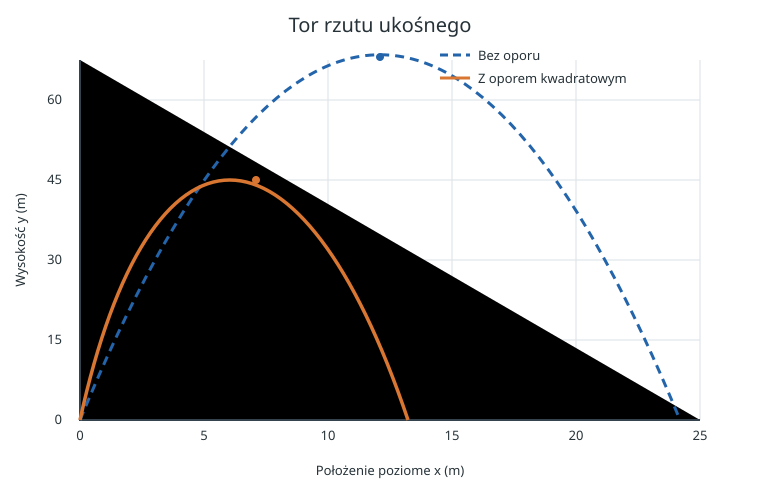
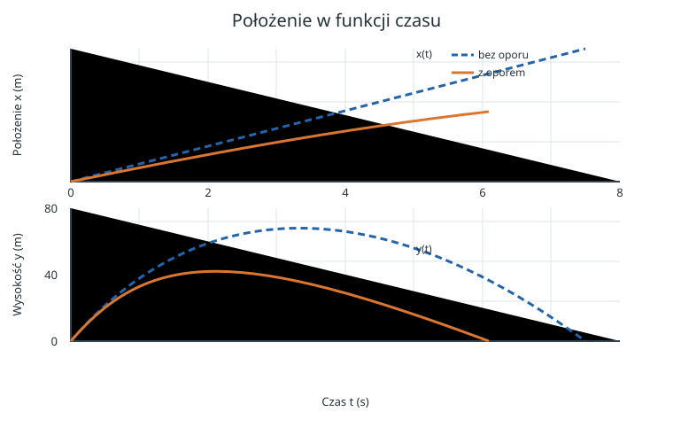
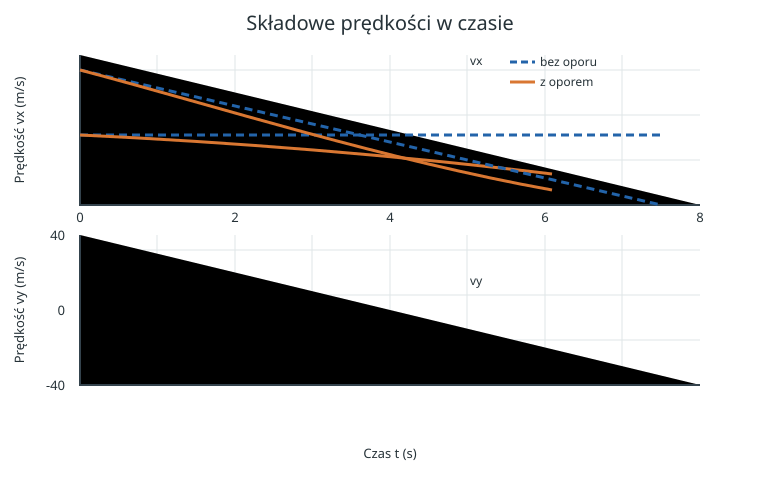
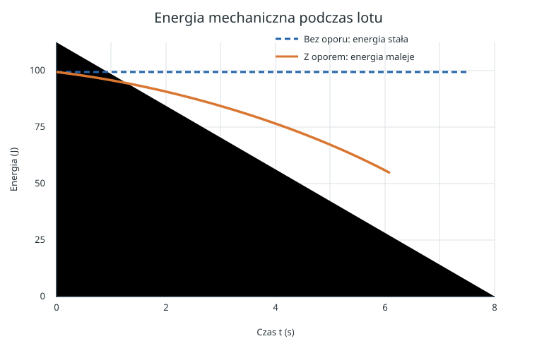

# Rzut ukośny bez oporu i z oporem powietrza

*Raport obliczeniowy: wyprowadzenie równań, symulacja numeryczna i porównanie dwóch modeli ruchu.*

**Warunki początkowe:** $v_0=37\,\mathrm{m/s}$, $\alpha=85^\circ$.  
**Metoda:** rozwiązanie analityczne bez oporu oraz całkowanie równania ruchu z oporem kwadratowym.  
**Charakter danych:** obliczenia modelowe, nie pomiar laboratoryjny.

Rzut ukośny można rozłożyć na dwa ruchy: poziomy i pionowy. Bez oporu powietrza te składowe są niezależne. Z oporem zależą od siebie, ponieważ siła aerodynamiczna przeciwdziała całemu wektorowi prędkości. Porównanie pokaże, jak ten pozornie niewielki szczegół zmienia wysokość, czas lotu i zasięg.

## Spis treści

1. [Model i założenia](#1-model-i-założenia)
2. [Rzut bez oporu powietrza](#2-rzut-bez-oporu-powietrza)
3. [Rzut z oporem powietrza](#3-rzut-z-oporem-powietrza)
4. [Wyniki i wykresy](#4-wyniki-i-wykresy)
5. [Kod i odtwarzanie obliczeń](#5-kod-i-odtwarzanie-obliczeń)
6. [Wnioski i ograniczenia](#6-wnioski-i-ograniczenia)

---

## 1. Model i założenia

Przyjmujemy płaski ruch w polu grawitacyjnym, stałe przyspieszenie grawitacyjne oraz start i lądowanie na tej samej wysokości. Oś $x$ jest pozioma, a oś $y$ skierowana pionowo w górę. Początek układu współrzędnych znajduje się w miejscu wyrzutu.

| Symbol | Znaczenie | Wartość lub jednostka SI |
| :--- | :--- | :---: |
| $v_0$ | wartość prędkości początkowej | $37\,\mathrm{m/s}$ |
| $\alpha$ | kąt nad poziomem | $85^\circ$ |
| $g$ | przyspieszenie grawitacyjne | $9{,}81\,\mathrm{m/s^2}$ |
| $m$ | masa modelowanej piłki | $0{,}145\,\mathrm{kg}$ |
| $D$ | średnica piłki | $0{,}074\,\mathrm{m}$ |
| $\rho$ | gęstość powietrza | $1{,}225\,\mathrm{kg/m^3}$ |
| $C_D$ | współczynnik oporu kuli | $0{,}47$ (bezwymiarowy) |
| $A$ | pole przekroju kuli, $\pi D^2/4$ | $0{,}004301\,\mathrm{m^2}$ |

Parametry $m$, $D$ i $C_D$ definiują konkretny, uproszczony przykład piłki. Nie wynikają z samych warunków początkowych; są dodatkowymi założeniami potrzebnymi do obliczenia oporu.

Składowe prędkości początkowej wynoszą:

$$
v_{0x}=v_0\cos\alpha=3{,}225\,\mathrm{m/s},\qquad
v_{0y}=v_0\sin\alpha=36{,}859\,\mathrm{m/s}.
$$

Kąt jest bliski pionowi, zatem pionowa składowa prędkości jest duża, a pozioma mała.

## 2. Rzut bez oporu powietrza

Jedyną siłą jest ciężar $\vec F_g=(0,-mg)$. Z drugiej zasady Newtona:

$$
m\ddot{x}=0,\qquad m\ddot{y}=-mg,
$$

czyli $\ddot{x}=0$ i $\ddot{y}=-g$. Całkując równania i stosując warunki początkowe $x(0)=y(0)=0$, $\dot{x}(0)=v_{0x}$ oraz $\dot{y}(0)=v_{0y}$, otrzymujemy:

$$
x(t)=v_0\cos\alpha\,t,\qquad
y(t)=v_0\sin\alpha\,t-\frac{1}{2}gt^2,
$$

$$
v_x(t)=v_0\cos\alpha,\qquad
v_y(t)=v_0\sin\alpha-gt.
$$

### 2.1. Czas wznoszenia, wysokość i czas lotu

W najwyższym punkcie $v_y=0$. Stąd:

$$
t_{\mathrm{wzn}}=\frac{v_0\sin\alpha}{g}=3{,}757\,\mathrm{s}.
$$

Podstawiamy ten czas do równania $y(t)$:

$$
h_{\max}=v_0\sin\alpha\,t_{\mathrm{wzn}}-\frac{1}{2}g t_{\mathrm{wzn}}^2
=\frac{v_0^2\sin^2\alpha}{2g}=69{,}246\,\mathrm{m}.
$$

Lądowanie następuje, gdy $y(t)=0$. Po wyłączeniu $t$:

$$
y(t)=t\left(v_0\sin\alpha-\frac{gt}{2}\right)=0.
$$

Rozwiązanie $t=0$ oznacza chwilę startu. Drugie rozwiązanie daje czas lotu:

$$
T=\frac{2v_0\sin\alpha}{g}=7{,}515\,\mathrm{s}.
$$

Poziomy zasięg wynika z ruchu jednostajnego w osi $x$:

$$
R=x(T)=v_0\cos\alpha\,T
=\frac{v_0^2\sin(2\alpha)}{g}=24{,}233\,\mathrm{m}.
$$

Wzór $R=v_0^2/g$ dotyczy kąta $45^\circ$ i nie jest ogólnym wzorem na zasięg. Tutaj $85^\circ$ daje mały zasięg, mimo dużej wysokości.

## 3. Rzut z oporem powietrza

Przyjmujemy opór aerodynamiczny kuli w zakresie, w którym można użyć modelu kwadratowego względem szybkości:

$$
\vec F_D=-\frac{1}{2}\rho C_D A\,|\vec v|\,\vec v.
$$

Znak minus oznacza, że siła jest skierowana przeciwnie do prędkości. Współczynnik $C_D$ jest bezwymiarowy, a $\frac12\rho C_D A$ ma jednostkę $\mathrm{kg/m}$. Oznaczając $c_D=\frac12\rho C_D A$, zapisujemy równania składowych:

$$
\dot{x}=v_x,\qquad \dot{y}=v_y,
$$

$$
\dot{v}_x=-\frac{c_D}{m}\sqrt{v_x^2+v_y^2}\,v_x,
\qquad
\dot{v}_y=-g-\frac{c_D}{m}\sqrt{v_x^2+v_y^2}\,v_y.
$$

Dla przyjętych danych $c_D=0{,}001236\,\mathrm{kg/m}$, a $c_D/m=0{,}008539\,\mathrm{m^{-1}}$. Równania są sprzężone: pionowa składowa prędkości wpływa na wartość siły hamującej również w osi poziomej.

Nie ma tu prostego rozwiązania paraboli. Układ równań całkujemy numerycznie metodą Rungego–Kutty czwartego rzędu (RK4), z krokiem $\Delta t=0{,}001\,\mathrm{s}$. W każdym kroku metoda oblicza pochodne w czterech punktach i łączy je wagami $1,2,2,1$; dzięki temu jest dokładniejsza od prostego przesuwania ciała o $v\Delta t$ przy stale przyspieszeniu z początku kroku. Koniec lotu wyznaczamy przez interpolację między ostatnim punktem nad podłożem a pierwszym punktem pod nim.

Prędkość graniczna przy swobodnym spadku w tym modelu wynika z równowagi ciężaru i oporu:

$$
mg=c_D v_{\mathrm{gr}}^2
\quad\Longrightarrow\quad
v_{\mathrm{gr}}=\sqrt{\frac{mg}{c_D}}=33{,}895\,\mathrm{m/s}.
$$

To wartość graniczna dla ruchu pionowego w dół, nie stała prędkość całego rzutu.

## 4. Wyniki i wykresy

| Wielkość | Bez oporu | Z oporem kwadratowym |
| :--- | ---: | ---: |
| Czas lotu | $7{,}515\,\mathrm{s}$ | $6{,}106\,\mathrm{s}$ |
| Czas do wierzchołka | $3{,}757\,\mathrm{s}$ | $2{,}853\,\mathrm{s}$ |
| Maksymalna wysokość | $69{,}246\,\mathrm{m}$ | $45{,}609\,\mathrm{m}$ |
| Zasięg | $24{,}233\,\mathrm{m}$ | $13{,}236\,\mathrm{m}$ |

W porównaniu z modelem bez oporu wysokość maksymalna maleje o około $34{,}1\%$, a zasięg o około $45{,}4\%$. Opór skraca również czas lotu, ponieważ ciało traci energię podczas wznoszenia i nie wraca na wysokość startu z taką samą wartością pionowej prędkości.



*Rysunek 1. Przy $\alpha=85^\circ$ tor bez oporu jest parabolą. Opór obniża wierzchołek i skraca zasięg.*



*Rysunek 2. W modelu bez oporu $x(t)$ rośnie liniowo. Z oporem prędkość pozioma maleje; pionowe przebiegi różnią się podczas wznoszenia i opadania.*



*Rysunek 3. Bez oporu $v_x$ jest stałe, a $v_y$ zmienia się liniowo. Z oporem obie składowe zmieniają się nieliniowo.*



*Rysunek 4. Bez oporu energia mechaniczna pozostaje stała. Opór rozprasza energię mechaniczną; energia potencjalna jest liczona względem poziomu startu.*

### Odczyt fizyczny

- W najwyższym punkcie $v_y=0$, ale $v_x$ nie musi być zerowe. Zatem ciało nie zatrzymuje się w wierzchołku toru.
- Bez oporu szybkość w wierzchołku wynosi $v_0\cos\alpha=3{,}225\,\mathrm{m/s}$. Z oporem zmniejsza się także składowa pozioma.
- W modelu z oporem maksymalna wysokość przypada wcześniej, a czas opadania nie jest równy czasowi wznoszenia.
- Opór nie jest stałą siłą pionową: podczas wznoszenia jego składowa pionowa jest skierowana w dół, a podczas opadania w górę.

## 5. Kod i odtwarzanie obliczeń

Pełny kod znajduje się w dołączonym pliku [`generuj_wykresy.py`](generuj_wykresy.py). Korzysta tylko z NumPy i Matplotlib, sam całkuje równania metodą RK4, tworzy cztery wykresy SVG i PNG oraz wypisuje wartości końcowe. Uruchom go z terminala w katalogu `pages/solutions/04_sol_vscode`:

```powershell
py -m pip install numpy matplotlib
py generuj_wykresy.py
```

Najważniejsza część modelu w Pythonie:

```python
def pochodne(stan, z_oporem):
    x, y, vx, vy = stan
    szybkosc = np.hypot(vx, vy)
    ax = -k_drag * szybkosc * vx if z_oporem else 0.0
    ay = -g - k_drag * szybkosc * vy if z_oporem else -g
    return np.array([vx, vy, ax, ay])

def krok_rk4(stan, dt, z_oporem):
    k1 = pochodne(stan, z_oporem)
    k2 = pochodne(stan + dt * k1 / 2, z_oporem)
    k3 = pochodne(stan + dt * k2 / 2, z_oporem)
    k4 = pochodne(stan + dt * k3, z_oporem)
    return stan + dt * (k1 + 2*k2 + 2*k3 + k4) / 6
```

Skrypt zapisuje wyniki do podfolderu `wykresy`. Załączone pliki SVG są czytelne po powiększeniu; uruchomienie skryptu odtwarza je z kodu oraz tworzy wersje PNG.

**Weryfikacja w tej sesji:** interpreter `C:\Python312\python.exe` (Python 3.12.2) wykonał niezależny model RK4 bez dodatkowych bibliotek. Otrzymano: bez oporu $T=7{,}514619\,\mathrm{s}$, $h_{\max}=69{,}245714\,\mathrm{m}$, $R=24{,}232860\,\mathrm{m}$; z oporem $T=6{,}105953\,\mathrm{s}$, $h_{\max}=45{,}609442\,\mathrm{m}$, $R=13{,}235556\,\mathrm{m}$. Są zgodne z tabelą po zaokrągleniu. Nie udało się uruchomić dołączonego generatora wykresów: interpreter nie ma zainstalowanych NumPy i Matplotlib, a plik workspace jest dostępny przez GitHub VFS, nie jako ścieżka lokalna terminala.

## 6. Wnioski i ograniczenia

1. Dla $v_0=37\,\mathrm{m/s}$ i $\alpha=85^\circ$ model idealny przewiduje zasięg $24{,}233\,\mathrm{m}$ i wysokość $69{,}246\,\mathrm{m}$.
2. Dla jawnie przyjętego modelu piłki oraz oporu kwadratowego otrzymujemy zasięg $13{,}236\,\mathrm{m}$ i wysokość $45{,}609\,\mathrm{m}$. Rzut niemal pionowy jest szczególnie wrażliwy na wpływ oporu podczas długiego wznoszenia.
3. Wynik z oporem zależy od masy, rozmiaru, kształtu ciała, gęstości powietrza i współczynnika $C_D$. Zmiana któregokolwiek z tych parametrów zmieni wynik.
4. Przyjęto stałe $\rho$ i $C_D$, brak wiatru, brak rotacji oraz stałe $g$. Nie uwzględniono efektu Magnusa, zmian gęstości powietrza z wysokością ani zależności $C_D$ od liczby Reynoldsa.
5. Model bez oporu jest użytecznym punktem odniesienia, ale przy tej prędkości i dla przyjętej piłki nie jest realistycznym opisem rzeczywistego lotu.
